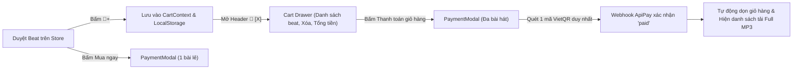

# Thiết kế Hệ thống Giỏ hàng Đa bài hát (Multi-Item Shopping Cart)

- **Ngày tạo**: 2026-10-17
- **Tác giả**: Antigravity & Nghao Producer
- **Dự án**: Nghao Producer Music Store (`nghaoproducer.shop`)
- **Trạng thái**: Đã thống nhất thiết kế (Approved)

---

## 1. Mục tiêu & Bối cảnh

Hiện tại, người mua beat chỉ có thể thanh toán từng bài hát một (Instant Buy 1 bài). Khi khách muốn mua từ 2 bài trở lên, họ phải lặp lại quy trình quét mã QR VietQR nhiều lần cho từng bài.

Hệ thống Giỏ hàng Đa bài hát (Multi-Item Shopping Cart) cho phép khách:
1. Duyệt nghe thử beat trên web và bấm thêm nhiều bài vào giỏ hàng mà không bị ngắt quãng trải nghiệm nghe nhạc.
2. Giữ nguyên nút "Mua ngay" cho khách mua lẻ 1 bài cực nhanh.
3. Xem danh sách giỏ hàng qua Cart Drawer trượt mượt từ cạnh phải màn hình.
4. Quét **1 mã VietQR duy nhất** để thanh toán toàn bộ giỏ hàng qua cổng ApiPay.
5. Sau khi thanh toán thành công, khách nhận link tải Full MP3 320kbps của tất cả các bài đã mua với cơ chế bảo vệ chữ ký số HMAC-SHA256.

---

## 2. Trải nghiệm Người dùng (UX Flow)



### Các trạng thái tương tác:
- **Nút "Mua ngay"**: Vẫn giữ nguyên trên từng thẻ bài hát và thanh audio player dưới đáy để phục vụ khách mua lẻ 1 bài.
- **Nút "🛒+" (Thêm vào giỏ)**: Đặt cạnh nút Mua ngay. Khi bài đã nằm trong giỏ, nút chuyển thành trạng thái `"Đã thêm"` kèm icon dấu tích để tránh thêm trùng.
- **Header Badge**: Icon giỏ hàng `🛒` kèm số lượng màu đỏ (ví dụ: `2`). Nhấp vào mở Cart Drawer.
- **Cart Drawer**: Trượt từ phải sang (Framer Motion, Dark Glass theme). Cho phép xóa từng bài, xóa toàn bộ, hiển thị tổng tiền cộng dồn chính xác.
- **Màn hình thành công (Success Phase)**: Hiển thị danh sách tất cả các bài đã mua, mỗi bài có nút tải MP3 Full riêng biệt và có nút "Tải tất cả bài hát".

---

## 3. Kiến trúc Frontend

### 3.1. `CartContext` (`src/context/CartContext.tsx`)
- Quản lý state toàn cục của giỏ hàng:
  - `items: Track[]`: Danh sách bài hát đang có trong giỏ.
  - `addToCart(track: Track): void`: Thêm bài hát vào giỏ (nếu chưa có).
  - `removeFromCart(trackId: string): void`: Xóa bài hát khỏi giỏ.
  - `clearCart(): void`: Dọn sạch giỏ hàng (sau khi thanh toán thành công).
  - `isInCart(trackId: string): boolean`: Kiểm tra bài hát đã có trong giỏ chưa.
  - `totalItems: number`: Số lượng bài hát trong giỏ.
  - `totalPrice: number`: Tổng tiền các bài hát trong giỏ (VND).
- Đồng bộ tự động với `localStorage` qua key `nghao_cart_items`.

### 3.2. `CartDrawer` (`src/components/CartDrawer.tsx`)
- Ngăn kéo trượt bằng Framer Motion:
  - Header: Tiêu đề "Giỏ hàng của bạn" + nút đóng (X).
  - Body: Danh sách bài hát (Bìa, tên bài, BPM/Thể loại, giá VND, nút xóa thùng rác). Nếu giỏ rỗng: hiển thị thông báo rỗng kèm nút "Khám phá Beat".
  - Footer: Tổng tiền, nút "Tiến hành thanh toán" (gọi `PaymentModal` với danh sách `tracks`).

### 3.3. Cập nhật `PaymentModal` (`src/components/PaymentModal.tsx`)
- Nhận props linh hoạt: `track?: Track | null` (cho đơn 1 bài) HOẶC `tracks?: Track[] | null` (cho đơn giỏ hàng nhiều bài).
- Khi tạo đơn:
  - Nếu là giỏ hàng: Gửi `trackIds: tracks.map(t => t.id)` lên API.
  - Nếu là 1 bài: Gửi `trackId: track.id`.
- Màn hình thanh toán thành công (`phase === "done"`):
  - Hiển thị danh sách từng bài hát đã mua với nút tải MP3 Full tương ứng (`/orders/:id/download?trackId=...&token=...`).

---

## 4. Kiến trúc Backend (`server/index.js` & `server/apipay.js`)

### 4.1. Khởi tạo đơn hàng (`POST /orders`)
- Nhận request body:
  ```json
  {
    "trackIds": ["track_1", "track_2"],
    "redirectUrl": "https://nghaoproducer.shop",
    "email": "customer@gmail.com",
    "phone": "0987654321"
  }
  ```
  *(Vẫn hỗ trợ body `{ "trackId": "track_1" }` cho tương thích ngược 100%)*
- Server tra cứu database:
  - Lấy danh sách các track tương ứng, loại bỏ track không tồn tại hoặc track free (`price <= 0`).
  - `totalAmount = sum(selectedTracks.map(t => t.price))`.
  - Sinh mã đơn: `orderId = ord_<timestamp>`.
  - Sinh mã nội dung chuyển khoản: `NGHAO <uniqueSuffix>`.
- Tạo payment request qua ApiPay với `amount = totalAmount` và `content = transferNote`.
- Cấu trúc đối tượng `order` lưu vào `db.orders`:
  ```json
  {
    "id": "ord_1792249000000",
    "trackId": "track_1",
    "trackIds": ["track_1", "track_2"],
    "items": [
      { "trackId": "track_1", "title": "Beat A", "price": 200000, "cover": "..." },
      { "trackId": "track_2", "title": "Beat B", "price": 200000, "cover": "..." }
    ],
    "amount": 400000,
    "transferNote": "NGHAO ABC123XYZ",
    "status": "pending_verification",
    "createdAt": "2026-10-17T15:00:00.000Z"
  }
  ```
- **Tương thích ngược tuyệt đối**: Thuộc tính `trackId` được gán bằng `trackIds[0]`. Mọi logic đối soát ngân hàng, bảng ReconciliationManager, OrdersManager cũ tiếp tục hoạt động trơn tru không lỗi.

### 4.2. Bảo mật tải nhạc MP3 Full (`GET /orders/:id/download`)
- Nhận tham số: `id`, `token`, và `trackId` (tuỳ chọn nếu đơn nhiều bài).
- Xác thực:
  1. Đơn hàng phải tồn tại và có `status === "paid"`.
  2. HMAC token hợp lệ được ký bởi server secret.
  3. `trackId` phải thuộc danh sách `order.trackIds` (hoặc bằng `order.trackId`).
- Stream trực tiếp file MP3 gốc từ Cloudinary về client với tên file chuẩn UTF-8 (`<Title> - NGHAO Full.mp3`), không lưu trữ trung gian gây tràn RAM máy chủ.

### 4.3. Đối soát & Hiển thị Admin
- Bảng `ReconciliationManager.tsx` và `OrdersManager.tsx`:
  - Đơn có nhiều bài hát sẽ hiển thị tên tóm tắt: `Beat A + 1 bài khác` (hover hoặc chi tiết hiện đầy đủ danh sách bài).
  - Số tiền và trạng thái khớp chuẩn xác 100%.

---

## 5. Kế hoạch Kiểm thử & Xác thực (Verification Plan)

1. **Unit Tests Backend (`node --test server/*.test.js`)**:
   - Test tạo đơn hàng đa bài hát (`trackIds`) và kiểm tra tính toán tổng tiền `amount`.
   - Test webhook thanh toán khớp tiền đối với đơn hàng đa bài hát.
   - Test xác thực token tải MP3 Full cho từng bài hát trong đơn đa bài hát.
   - Test đảm bảo 27 unit tests hiện tại tiếp tục pass 100% không bị regression.
2. **Frontend Build & Integration (`npm run build`)**:
   - Kiểm tra TypeScript biên dịch không có lỗi kiểu dữ liệu (`tsc`).
   - Kiểm tra thêm/xóa bài hát vào giỏ, cập nhật badge giỏ hàng trên Header.
   - Kiểm tra mở Cart Drawer, tính tổng tiền, mở PaymentModal thanh toán.
3. **Triển khai Production (`git commit & push`)**:
   - Đẩy mã nguồn lên Vercel production và xác nhận hoạt động trực tiếp trên `nghaoproducer.shop`.
